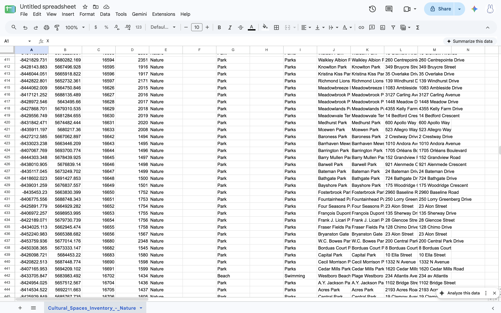
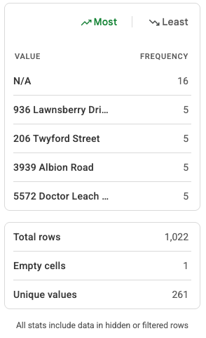
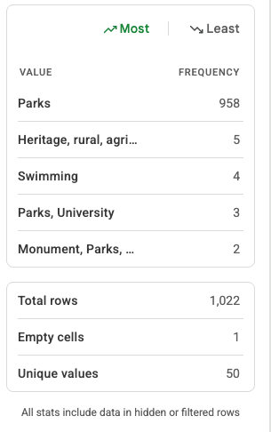
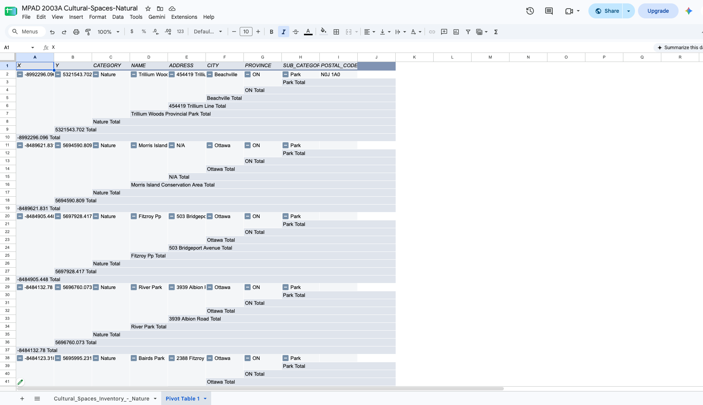
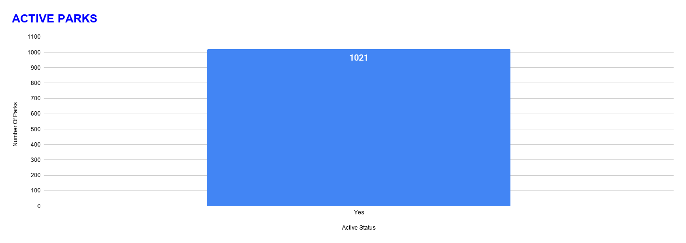

**October 31st 2026** 
**MPAD2003A Introductory Data Storytelling** 
**Makayla McLean** 
**Presented to Jean-Sébastien Marier** 

# Deliverable 2: Exploratory Data Analysis (EDA)

## Why I chose this dataset:
I chose a dataset that includes the locations of cultural spaces considered natural around the city of Ottawa, found on this page of Open Ottawa’s website: https://open.ottawa.ca/datasets/e68f322f9ccc4982ba8f973df4335158_137/explore?location=45.093626%2C-75.745170%2C0 . I chose this dataset because I think it would be fun and helpful to create a visual map using the park locations. I also decided to work with a dataset related directly to something I like and that I would personally find useful. It's also important to inform people about the current environmental state and how these parks and green spaces affect our quality of life and the overall quality of our city.
​
## General Observations of the dataset
I think columns E, D and C contain the most important information that I should use to create my data driven story. Column D contains nominal variables with the names of each park. Column E also contains nominal variables with the addresses of the parks. Column C also contains nominal variables, specifically categorical nominal variables with the tags for each park. The webpage the data comes from states that “The City will be developing a plan for the long-term maintenance of this dataset. The data will be updated frequently, but there can be outdated information” (City of Ottawa, 2023)
​
## How I imported the dataset
First, I retrieved the dataset from the open ottawa database, then I downloaded the CSV file that was linked to the page. I then created a Google Sheets document, to which I used the import option to open the CSV file within Google Sheets.

 
*figure 1: image of Google sheets document after CSV file has been imported* https://docs.google.com/spreadsheets/d/1mL5dRG-e_hPMJYjxaj1WzpE-BggnnTr5Zg7sfHNtjDs/edit?usp=sharing

## 2. Understanding Data

### 2.1. VIMO Analysis
I have chosen to conduct my VIMO analysis on columns E, D and C.
Column D contains the names of all the parks there are a total of 1022 unique values  including the title cell there are no empty cells and all contain valid unique park names to match those of the one within the city of Ottawa. I am unable to properly cross-check the names of every park.
Column E contains the addresses of each park in the city of Ottawa; there are a total of 1022 rows and 261 unique values. There are a total of 16 values labelled as N/A and exactly one empty cell. I am unable to properly cross check each location; there are a few locations that are listed multiple times. Figure 4 shows the information that is given when selecting the "column stats” under the “data” category at the top of the page on Google Sheets.

 
*Figure 2: "Column Stats for Column E*

The last column I chose to conduct a VIMO analysis on is column C, which contains the tags connected to each park. There are a total of 1022 rows and a total of 50 unique values. 958 of those values are “park”; the tags that are listed contain valid types of cultural spaces in the natural category, such as “parks, university”, “swimming”, “Heritage, rural, agriculture, conservation”, etc. Figure 5 shows the information that is given when selecting the "columns stats” under the “data” category at the top of the page on Google Sheets.

 
*Figure 3: "Column Stats" for Column C*

### 2.2. Cleaning Data
When cleaning the data, there were not many errors or duplicates. This data set is recent therefore it's not likely to be missing a park that was registered recently.
All rows with Important information such as location (rows A, B, L, M, P, O, AH, and AI), Park name(rows J, and K), and object ID (row C) are all filled in and don’t have any blank cells.
I started off by removing the french version of each column, as it contains the same information as the english columns. I then removed all empty columns and those of which I will not be using for my data driven story. I looked at the suggestions provided by Google Sheets once I imported the file. The google sheets cleanup tool found around 18 different cells with white space that could be trimmed down. I looked over the cells it flagged and accepted those that needed trimming. When looking for duplicates, the Google Sheets data cleaning tool did not find any duplicate cells. I then used the function `=E1:E1022 & " " & F1:F1022` to combine columns E and F into one. OpenRefine edited a total of 49 cells when I selected the option to clear and trim out white spaces.

### 2.3. Analyzing Data
The dataset comes directly from the Open Ottawa website. It only includes registered parks within the city of Ottawa. The page where the file is found explains that the data was collected by the Apartment 613 community to create an updated inventory list of cultural spaces in Ottawa.
Apartment 613 is a community-driven non-profit organization which focuses on sharing culture, foods, art, music, events, and more. I chose to focus on keeping the locations and names of all the parks whether they're active, what they are, and tags the parks are under, to help make my potential map useful for people who are looking for a park that is within a specific category.
I created a pivot table to help only show the most important information that I would require to make my data driven story. I included the location names, addresses, activity status, category, etc. These will be used to create the visual map of the locations of the parks within the city.

 
*Figure 4: this pivot table shows rows A to J and up to column 41, containing the x,y coordinates, category, name, address, city, province,sub category, and postal code listed in the original dataset.*

For my exploratory chart I created a chart that shows the active status for all the parks in the data set. This is important because it shows how many of the parks are available to visit or use. It shows that currently all 1021 parks are active. 

 
*Figure 5: this exploratory chart shows all the parks activity status, 1021 parks total are currently active in Ottawa.*

## 3. Delivering Data
For this story, I would have to do some research on the impacts of parks and natural spaces on the community and ecosystem/environment of the city. Along with this, I would also benefit from doing general research on how parks can improve quality of life and their environmental impacts.
On the story section of the About Us page on the Apartment 613 website, it explains that: This organization was started by a group of friends who wanted to create an easier way to “tap into Ottawa’s vibrant arts and culture scene without insider connections” (apt613.ca). Interviewing someone who helped collect the data or works within the Apartment 613 organization would be a great opportunity to learn about why they thought creating an inventory of cultural spaces was important and how they personally think it could be used to better our city. They could also explain how they retrieved the data, how long the data took to be collected, and if there are any changes that should be made to it. Apartment 613 is widely run by volunteers who publish their stories or provide information about events around Ottawa. Speaking with someone who is an active contributor would be a great way to discuss ideas on how to work with this data to create a visual story that would help the public be able to find and access cultural spaces.

## 4. References

Grammarly was used to spell and grammar check the text written, google sheets and open refine were used to clean and organize the data. References course materials to create the pivot table and exploratory chart. Google was used to search for the type of function used in the cleaning data section of my EDA. 

apartment 613 instagram:
    https://www.instagram.com/apt613?rpxt=MXhnMmZrMHV3bXk5bQ== 

(n.d.). https://apt613.ca 

City of Ottawa. (2023, April 14). Cultural Spaces Inventory - Nature.  Retrieved November 2, 2026, from https://open.ottawa.ca/   datasets/ottawa::cultural-spaces-inventory-nature/about 
